<p align="center">
  
</p>

<h1 align="center">N2O Paper</h1>

<p align="center">
  <strong>A light theme for Obsidian that reads like paper on a desk.</strong><br/>
  Warm cream sheets, bookcloth sidebars, tape and pencil marks, and seven colour palettes taken from the traditional colours of Japan.
</p>

<p align="center">
  <a href="https://github.com/n2osync/n2o-paper/releases/latest"></a>
  
  
  
</p>

<p align="center">
  <a href="https://n2osync.com">Website</a> /
  <a href="https://github.com/n2osync/n2o-paper-settings">N2O Settings</a> /
  <a href="https://github.com/n2osync/n2o-paper/issues/new">Report a bug</a> /
  <a href="https://github.com/n2osync/n2o-paper/issues/new">Request a feature</a>
</p>

<p align="center">
  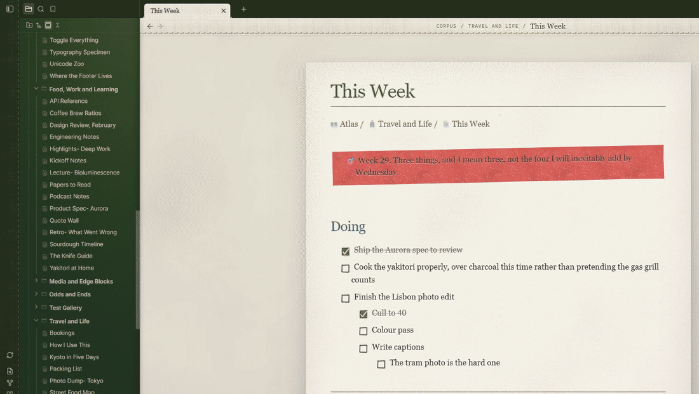
</p>

---

<p align="center">
  <b>Contents</b>
</p>

<p align="center">
  <a href="#a-page-not-a-screen">A page, not a screen</a> /
  <a href="#n2o-settings-highly-recommended">N2O Settings</a> /
  <a href="#the-details-we-sweated">The details we sweated</a> /
  <a href="#thirteen-callouts">Thirteen callouts</a> /
  <a href="#quotes">Quotes</a>
  <br/>
  <a href="#seven-palettes">Seven palettes</a> /
  <a href="#pictures">Pictures</a> /
  <a href="#the-four-things-you-can-write">How to write one</a> /
  <a href="#the-flags">The flags</a> /
  <a href="#flags-and-a-caption-together">Flags + caption</a>
  <br/>
  <a href="#sizing-and-the-one-thing-that-catches-people">Sizing</a> /
  <a href="#captions">Captions</a> /
  <a href="#embedded-notes">Embedded notes</a> /
  <a href="#the-rest-of-the-page">The rest of the page</a> /
  <a href="#made-to-be-read">Made to be read</a>
  <br/>
  <a href="#better-on-real-pages">Better on real pages</a> /
  <a href="#one-note-on-its-own">One note on its own</a> /
  <a href="#make-it-yours">Make it yours</a> /
  <a href="#install">Install</a> /
  <a href="#light-only">Light only</a> /
  <a href="#licence">Licence</a>
</p>

---

> **Not an Obsidian product.** N2O Paper is an independent theme. It is not made
> by, endorsed by, or affiliated with Obsidian.

## A page, not a screen

The window is a desk. The note is a sheet of cream stock resting on it, with a
grain you can see at full zoom and never at reading distance, and a light that
falls from the top left and softens at the foot of the page. Down the left runs
a black bookcloth spine, and the sidebar takes the palette's colour.

<p align="center">
  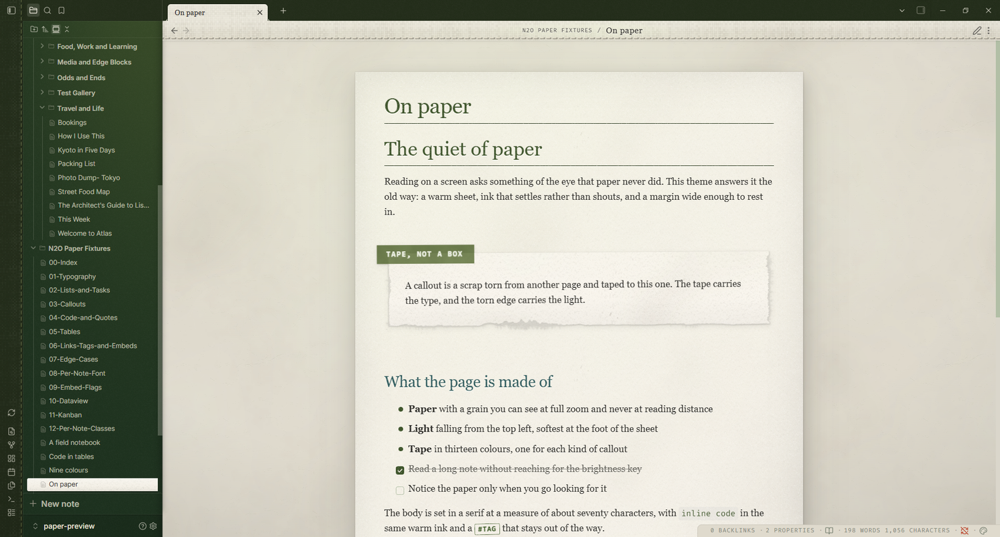
</p>

The sheet keeps a column you can read. With Readable line length on it is
Obsidian's own width. With it off, the sheet stops at 860 px instead of running
the width of the window, unless you turn on **Full width** or type a column
width of your own.

## N2O Settings, highly recommended

The theme is complete on its own. Every default below is the theme's own, and
nothing else is needed to read with it.

**N2O Settings is highly recommended, never required.** A theme is CSS and
cannot draw a settings tab, so the 134 controls are drawn by
**[N2O Settings](https://github.com/n2osync/n2o-paper-settings)**, free and in
the community plugin list. It opens on a short list of quick choices (preset,
palette, flat paper, column width, coil binding, font set, text size, callout
style), then 12 pages for the rest, and Obsidian's settings search finds every
control in them.

> Search **N2O Settings** in Settings, Community plugins, Browse. It installs
> this theme for you as well, so either one can come first.

<p align="center">
  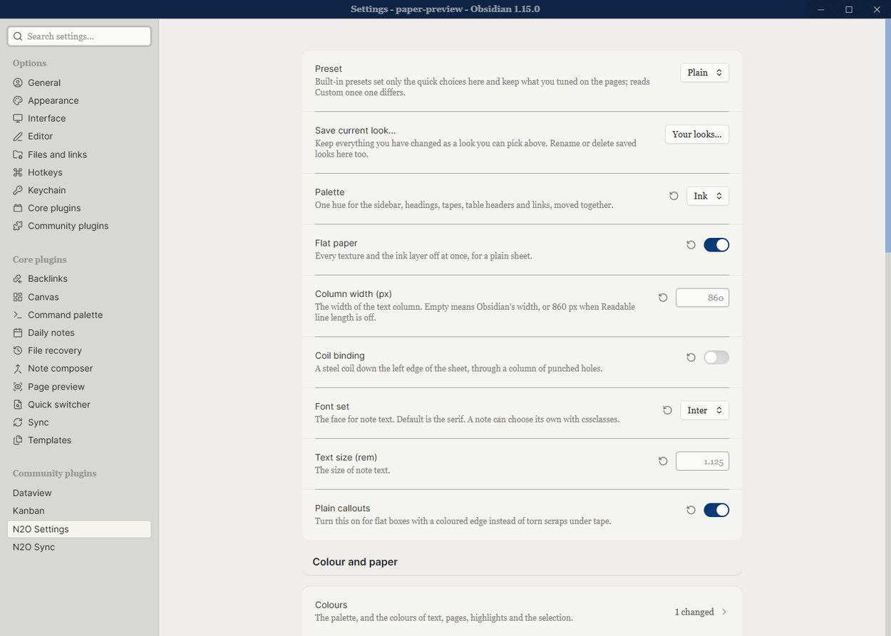
</p>

## The details we sweated

**A callout is a scrap of paper taped to the sheet.** The tape carries the type,
in one of thirteen colours. The torn edge is a real tear, and the shadow follows
the tear rather than a rectangle.

<p align="center">
  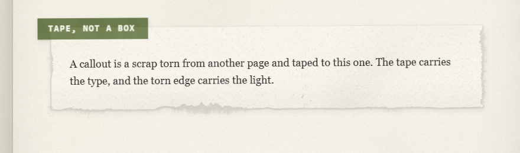
</p>

**Tasks are pencil marks.** A checked box is drawn in pencil, and the line
through the text is struck in the same hand.

<p align="center">
  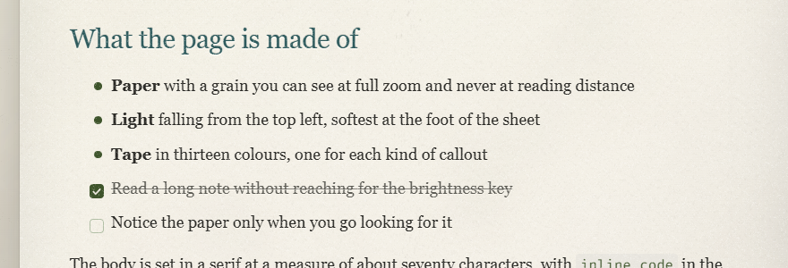
</p>

**Code sits on its own slab**, syntax coloured, with no paper texture over it,
and it looks the same in every palette. Live preview draws a code block as one
slab too.

<p align="center">
  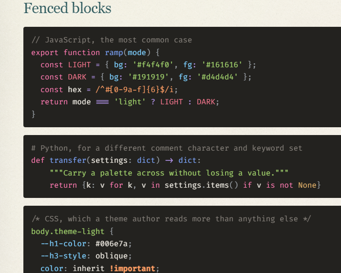
</p>

**Tables are cards**, with a coloured header band, hairline rules and a quiet
alternating tint. Dataview and Kanban get the same treatment.

<p align="center">
  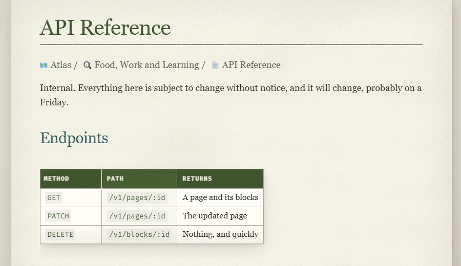
</p>

## Thirteen callouts

Every type Obsidian ships, each with its own tape colour. The tape lands in a
different place on each one, and the tint of the paper shifts with the type.

<p align="center">
  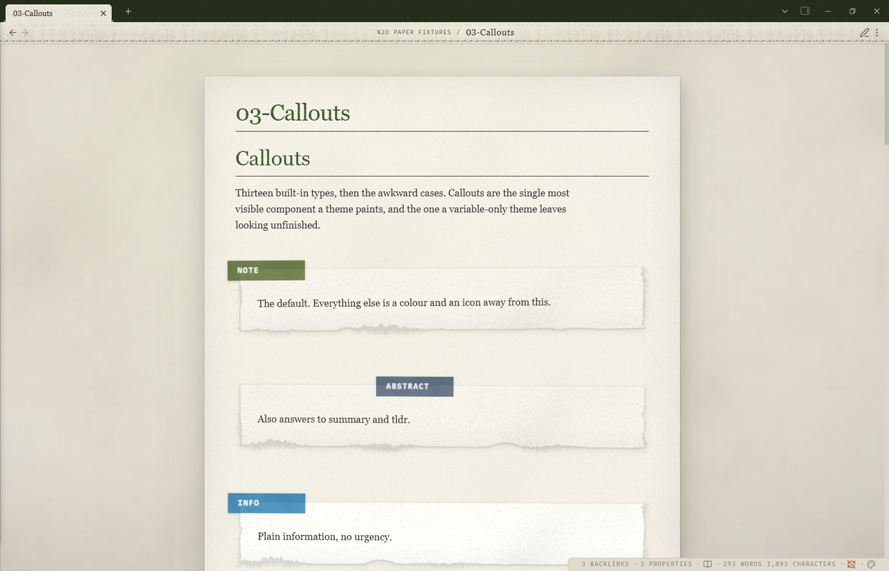
</p>

Four styles for the same thirteen: taped scraps by default, cards with a header
band, quiet callouts on cream, or plain boxes with a coloured edge and no tear.

<p align="center">
  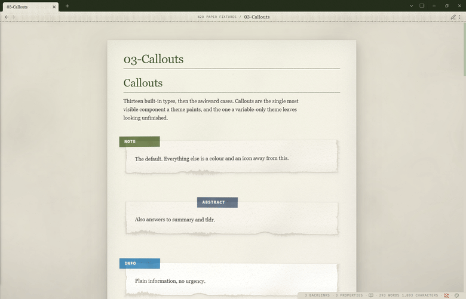
</p>

## Quotes

A quote is a sheet with a coil binding down its left edge. Punched holes, a
tinted page, and the binding grows with the quote rather than sitting as a stub
beside one line. Nest them and each level gets its own sheet.

<p align="center">
  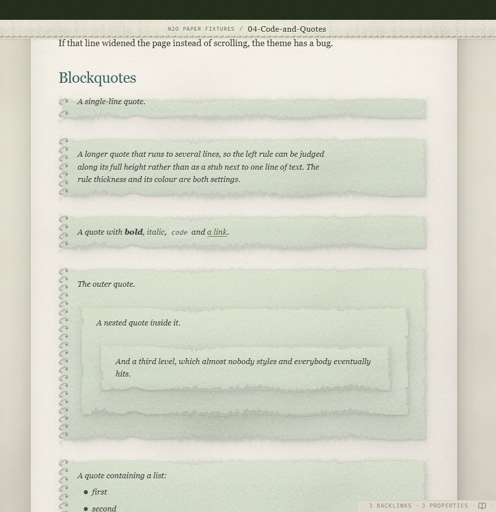
</p>

## Seven palettes

One hue runs through the whole app: the title, the links, the table header, the
sidebar, and the O of the N2O mark if you use N2O Sync. Five of the
seven take exact colours from the traditional colours of Japan.

**Forest**, the theme's own, measured from two meadow photographs.

<p align="center">
  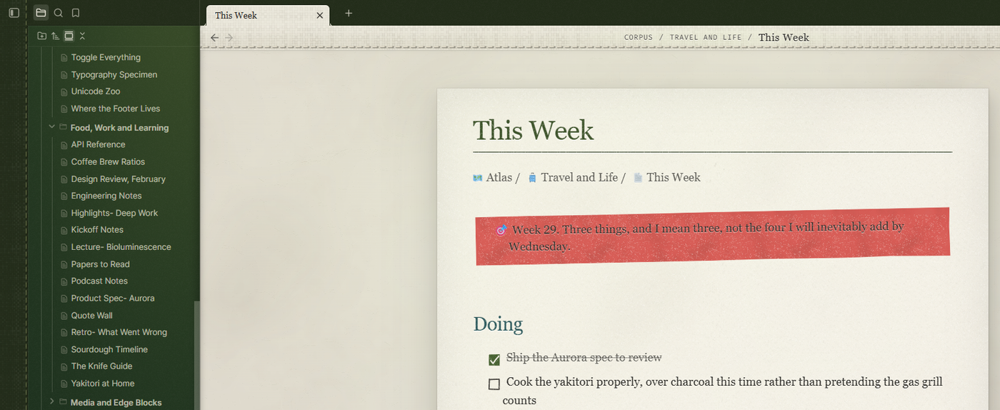
</p>

**Ink**, indigo dyeing: navy cloth, deep blue, a forget-me-not light.

<p align="center">
  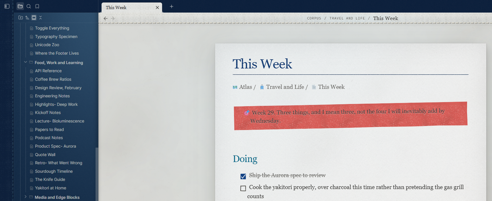
</p>

**Oxblood**, a dark blood red with an ENJI glow on the sidebars.

<p align="center">
  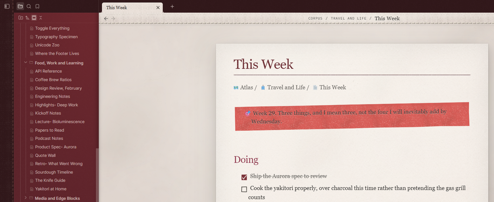
</p>

**Rose**, rose in bloom, NAKABENI light on cream paper.

<p align="center">
  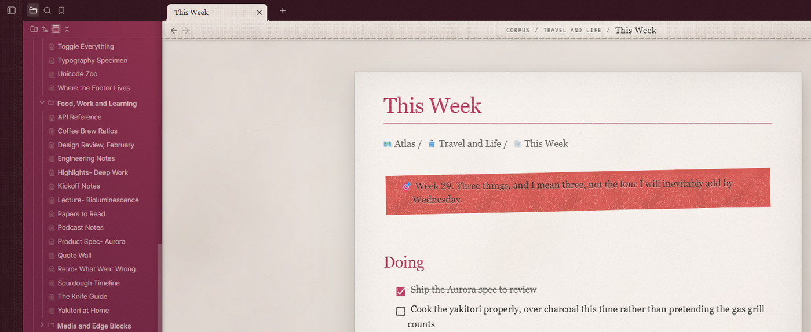
</p>

**Sepia**, a tea house: scorched tea, chestnut, amber, a celadon cup.

<p align="center">
  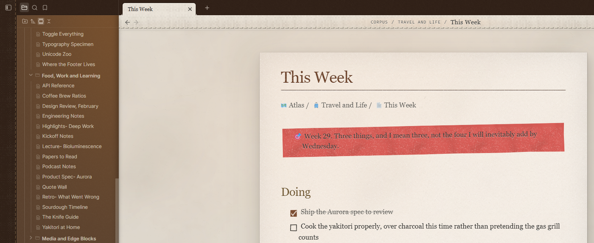
</p>

**Graphite** is pencil lead and **Coal** is sumi ink, both monochrome.

<p align="center">
  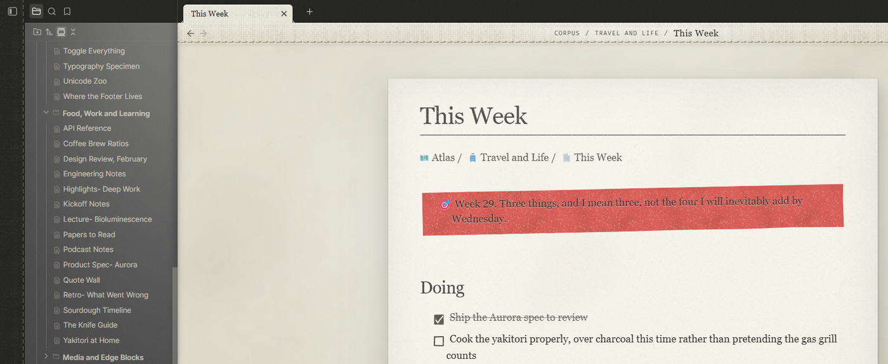
</p>

And Coal, sumi ink.

<p align="center">
  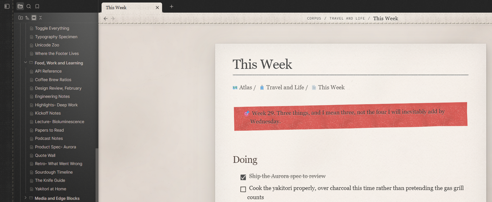
</p>

## Pictures

A picture is an instant print laid on the sheet. Warm white frame paper with a
grain of its own, deeper at the foot, a hairline edge, and one corner lifting a
little. That is the default: write the embed and you get the print.

```
![[cabin.png]]
```

Everything past that is written after a pipe. Obsidian puts what follows the
pipe into the picture's alt text, and the theme reads it.

### The four things you can write

Every picture takes up to four pieces, in this order, each separated by a pipe:

```
![[ file | flags | caption | width ]]
```

You can leave any of them out. The order is what matters, not the count.

| What you write | What you get |
|---|---|
| `![[cabin.png]]` | the print, on the sheet |
| `![[cabin.png\|400]]` | the print, 400px wide |
| `![[cabin.png\|A cabin in the pines]]` | captioned in pen along the foot |
| `![[cabin.png\|A cabin in the pines\|400]]` | captioned, 400px wide |
| `![[cabin.png\|left]]` | floated into the left margin |
| `![[cabin.png\|aged\|A cabin in the pines\|400]]` | aged, captioned and sized, all three |

### The flags

A flag is a single word in the flags position. Six of them do something:

| Flag | What it does |
|---|---|
| `left` | floats the picture into the left margin, the text wrapping past it |
| `right` | the same on the right |
| `round` | a round print, no frame and no caption, because there is no foot to write on |
| `aged` | one photo faded warm, with dust, fine scratches and a crease |
| `seamless` | for an embedded NOTE: no frame, no paperclip, the text flowing straight in |
| `torn` | for an embedded NOTE: a torn scrap of khaki |

`left` and `right` put the picture in the margin and let the text run past it.

<p align="center">
  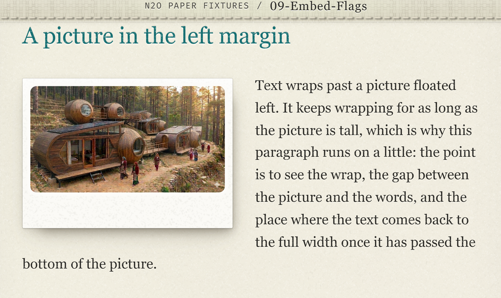
</p>

`round` drops the frame altogether, so there is no foot and no caption.

<p align="center">
  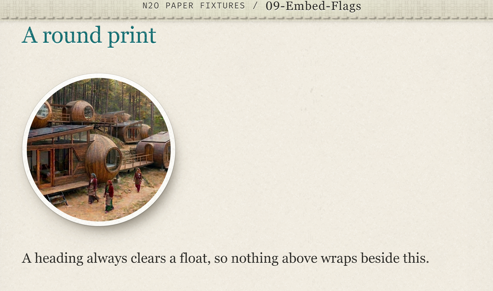
</p>

`aged` fades one print warm and handles it: dust, fine scratches, a crease,
worn pale edges and corners gone dark.

<p align="center">
  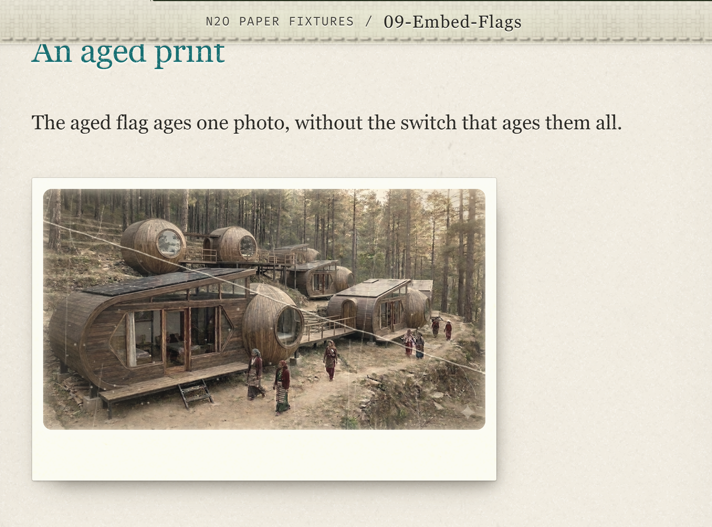
</p>

With N2O Settings installed you can also right-click a picture to resize it or
set these flags from a menu.

### Flags and a caption together

Put the flag first, the caption after it, a pipe between them:

```
![[cabin.png|aged|A cabin in the pines|340]]
```

<p align="center">
  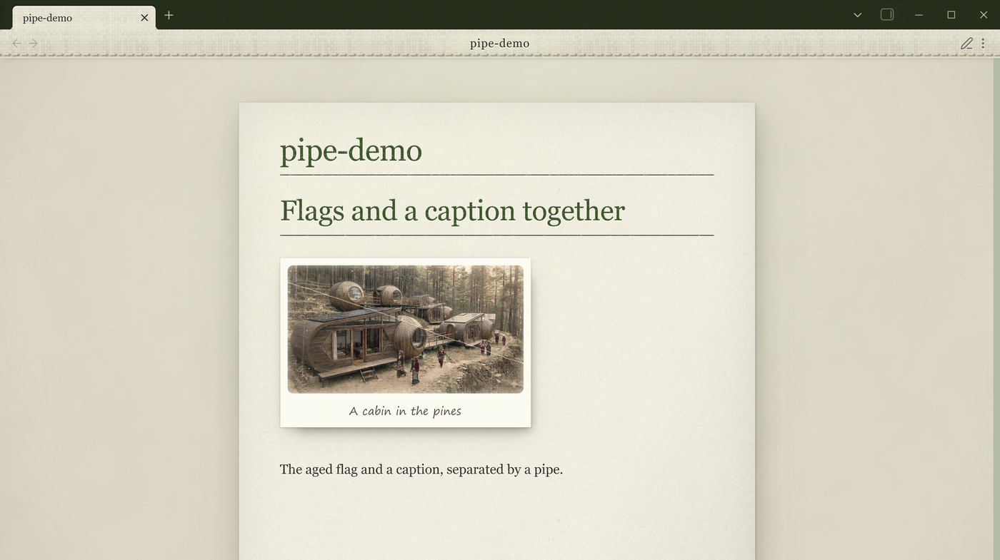
</p>

**This one needs N2O Settings.** A theme is CSS, the caption it draws is the alt
text itself, and CSS cannot take a word out of the middle of an attribute. The
plugin splits the two apart for it. Without the plugin the flag and the caption
still work on their own, just not together.

The pipe is what makes it unambiguous. A caption is free to contain a flag word:

```
![[seine.png|left|The left bank of the Seine|320]]
```

floats the picture and captions it "The left bank of the Seine", with the word
`left` left alone where it belongs.

### Sizing, and the one thing that catches people

The width goes LAST, after its own pipe:

```
![[cabin.png|left|300]]     300px wide, in the left margin
![[cabin.png|left 300]]     left margin, and NO width
```

The second one looks like it should work and does not. `left 300` is one piece
of text: the theme sees the word `left` in it and floats the picture, Obsidian
sees no width field at all and sets none.

<p align="center">
  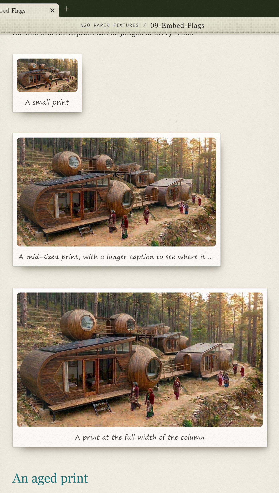
</p>

### Captions

The caption is written in pen across the foot of the print.

<p align="center">
  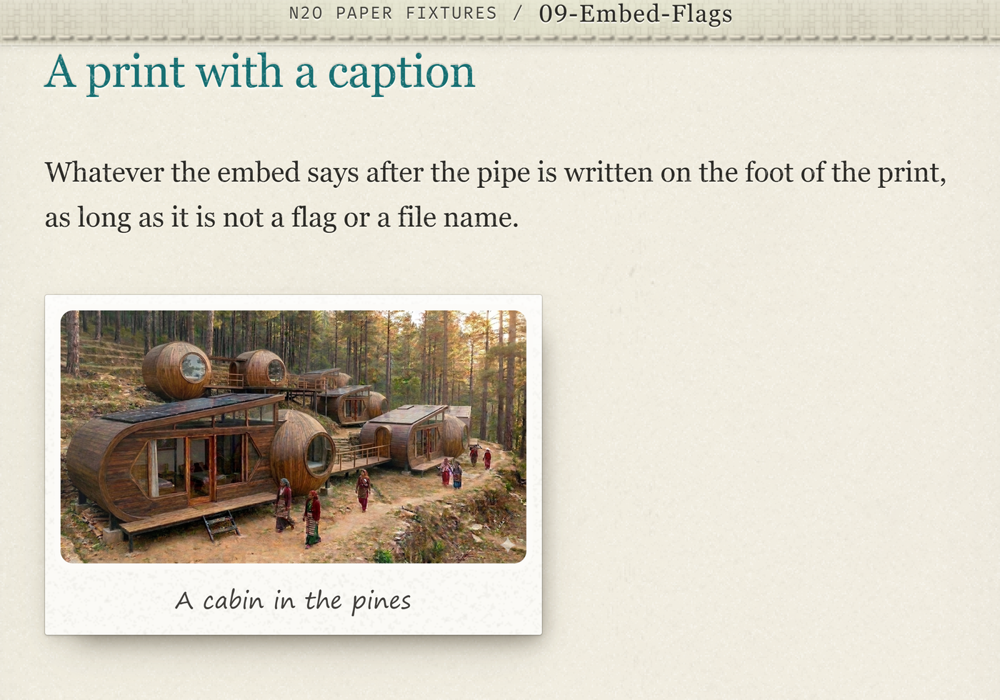
</p>

A bare file name is not a caption: `.png`, `.jpg`, `.jpeg`, `.gif`, `.webp`,
`.svg`, `.avif` and `.bmp` are recognised and left off, so a picture you never
captioned stays clean instead of being labelled with its own filename.

### Embedded notes

A note embedded in another note is a sheet held on with a steel paperclip.

| What you write | What you get |
|---|---|
| `![[note]]` | the sheet, with the clip over its top edge |
| `![[note\|seamless]]` | no frame and no clip, the text flowing straight in |
| `![[note\|torn]]` | a torn scrap of khaki |

`seamless`, for a note that should read as part of the page:

<p align="center">
  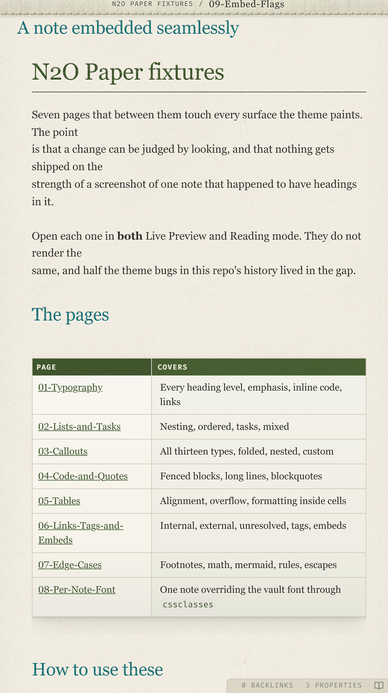
</p>

`torn`, for one that should read as something slipped in:

<p align="center">
  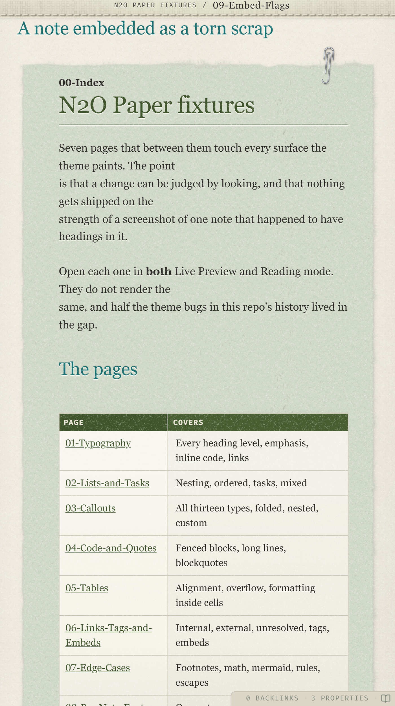
</p>

## The rest of the page

Nothing is left in Obsidian's default look.

**Lists and tasks.** Each level has its own bullet, and pencil checkboxes.

<p align="center">
  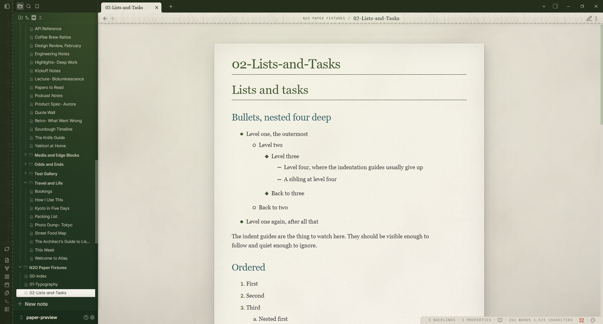
</p>

**Tables**, as cards with a coloured header band and hairline rules.

<p align="center">
  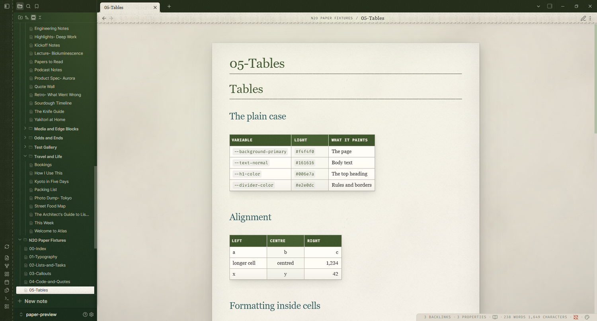
</p>

**Links, tags and embeds.** Tags are stamped, links take the palette's hue.

<p align="center">
  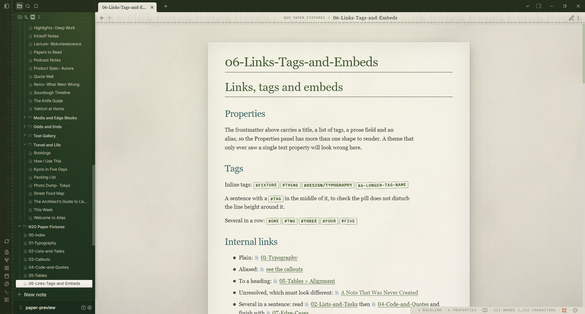
</p>

**Dataview**, given the same card treatment as a plain table.

<p align="center">
  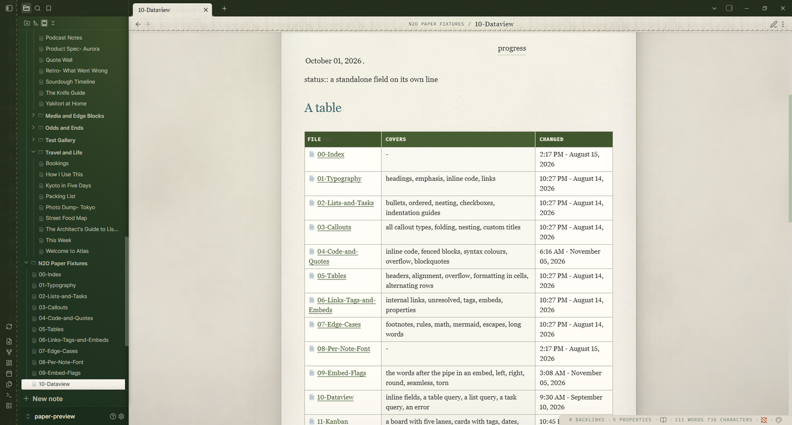
</p>

**Kanban.** The board is a desk, each lane a sheet, each card a slip of paper.

<p align="center">
  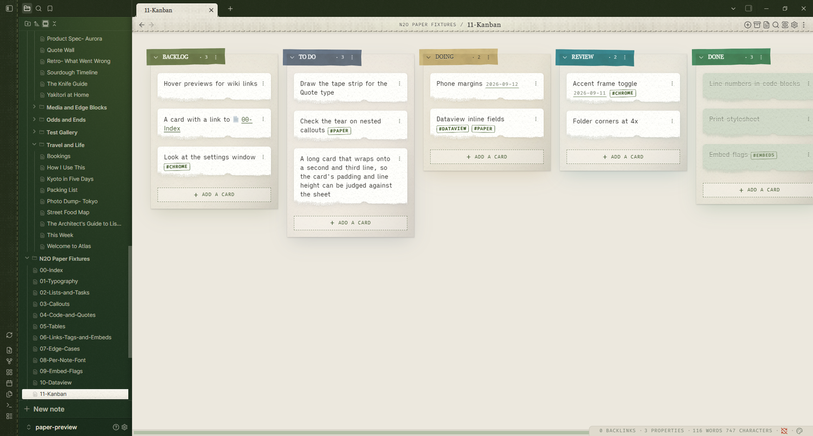
</p>

## Made to be read

Long reading was the whole point, so the type is set for it: a serif body at a
measure you can follow, headings that step down in colour rather than shout in
size, and a page that holds its measure when you split the window or open it on
a phone.

<p align="center">
  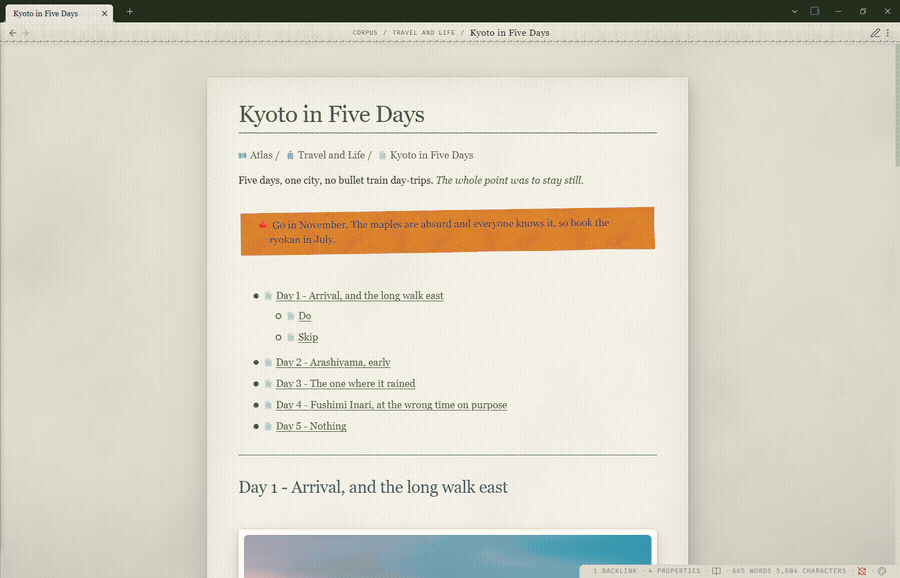
</p>

The palette is deliberately soft. Ink that settles rather than shouts, pale
teals and warm greys, so an hour in a note is an hour your eyes can take.

## Better on real pages

This release was checked against a hundred real notes and fifty pages synced
from Notion, not only hand-written test pages. What changed:

- A one-line callout shows its whole sentence instead of cutting it off.
- A folded callout is just its tape and fold arrow, not an empty torn strip.
- A code fence with no language looks like code in both reading view and live
  preview. Turn on **Plain fences on paper** under Code to set it in the text
  face instead.
- Live preview draws a code block as one slab, not a stack of pills.
- Properties in live preview are their normal size.
- No grey bars beside bold words and links in live preview.
- A heading wrapped in bold keeps the heading colour.
- Lists keep one rhythm in both modes, with the bullet clear of the text.
- Wide tables fit the sheet: the header row wraps instead of running off the
  edge.
- Dates and numbers in tables use lining figures, so 01/13 no longer reads as
  o1/13.
- A wrapped quote line in live preview stays clear of the rule.
- The ribbon and the spine are styled again on Obsidian 1.15.

## One note on its own

Add these to a note's `cssclasses` property to change that note alone. They
combine, and they work without N2O Settings.

| Class | What it does |
|---|---|
| `paper-wide` | a column 1.6 times the readable width |
| `paper-flat` | no texture or ink layer on the sheet and its scraps |
| `paper-plain-callouts` | callouts as plain boxes with a coloured edge |
| `paper-no-coil` | no coil on the sheet or on quotes |
| `paper-palette-forest`, `-ink`, `-oxblood`, `-graphite`, `-sepia`, `-rose`, `-coal` | the note's text, headings, links and highlight in that palette |
| `n2o-font-default`, `n2o-font-inter`, `n2o-font-ibm`, `n2o-font-fira`, `n2o-font-iawriter-quattro` | the note's own font set |

## Make it yours

All 134 controls live in
[N2O Settings](https://github.com/n2osync/n2o-paper-settings), free and in the
community plugin list. Three looks set several at once: **Reading** (the
theme's own textured paper, serif, torn callouts), **Writing** (lighter paper,
sans, plain callouts) and **Plain** (flat paper, no coil, plain callouts, quiet
chrome). You can save your own looks too.

The 12 pages:

- **Colours**: the seven palettes, and the text, page, highlight and selection
  colours, each with an opacity.
- **Paper and desk**: flat paper, flat type and rules, column width, full
  width, desk margin, texture, light, and the coil binding.
- **Text**: font set, a custom font stack, interface font, flat emoji, text
  size, line height, bold and italic, links, tags, note title and properties.
- **Headings**: a heading font apart from the text, scale, letter spacing, the
  rule under H1, and each level's colour, size and weight.
- **Callouts and quotes**: torn scraps, plain boxes, cards or quiet callouts,
  and the coil on quotes.
- **Lists and tasks**: bullet style, numbering, indent, indent guides, and
  pencil or plain checkboxes.
- **Tables**, **Code** and **Pictures**.
- **Window and sidebars**: spine, right sidebar material, file explorer rows,
  tab bar height and corners.
- **Synced from Notion**: how pages synced by N2O Sync are drawn.
- **Accessibility**: reduce motion, higher contrast and larger interface text.
  The system's reduced motion setting is honoured without the plugin, and under
  forced colours the textures and torn edges drop away.

Export copies what you changed to the clipboard, and Import asks whether to
merge it with your values or replace them.

## Install

Settings > Appearance > Themes > Manage, then search for N2O Paper.

To install it by hand, download `theme.css` and `manifest.json` from the latest
release into `<vault>/.obsidian/themes/N2O Paper/`, then pick the theme in
Appearance.

## Light only

N2O Paper is a light theme. In dark mode it applies nothing and Obsidian's own
dark look shows, so there is no half painted page. N2O Settings applies nothing
in dark mode either.

## Licence

MIT. See LICENSE.md.
